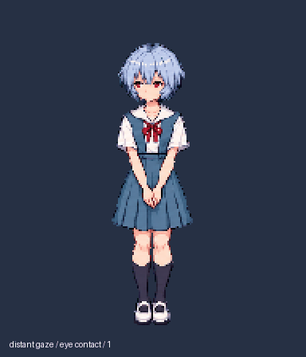

# Rei · ChatGPT Pets

绫波丽校服像素动画素材，适配 ChatGPT Pets v2 图集。当前版本 **v3：人物注意力、读书与旧眼镜**。



## 动作

- **待机**：远望、眨眼、短暂对视，再移开目光。
- **工作**：捧书阅读，视线追踪页面，指尖翻页。
- **等待**：低头后慢慢抬眼，安静注视，轻微询问式歪头。
- **检查**：看页、轻点头、合书再展开，短暂淡笑。
- **失败**：双手珍惜地托住旧眼镜，低头失落后缓慢恢复。
- 另含挥手、左右移动、跳跃与十六个视线方向。

人物保持冰蓝短发、红眼、蓝白校服、红领结、深色长袜和白鞋。素材采用保留硬像素边缘的最近邻缩放。

## 下载与预览

- [最终透明 PNG 图集](final/spritesheet-extended.png)
- [完整动作 GIF](previews/all-states.gif) / [MP4](previews/all-states.mp4)
- [五组人物动作 GIF](previews/personality-focus.gif)
- [各状态独立 GIF](previews/states/)
- [待机—跳跃—待机](previews/idle-jump-idle.gif)
- [十六方向循环](previews/look-loop.gif)
- [动作联系表](qa/contact-sheet-final.png)

图集：`1536 × 2288`，8 列 × 11 行，每格 `192 × 208`，73 个有效帧，15 个空白格。PNG 为 RGBA，大小 1,273,154 字节。

SHA-256：`cb31abbf8f4bee2b1fa1d73e65d13bc26b63a5f47f19181bd6b51fc9d6d758f9`。

| 行 | 状态 | 帧数 |
| --- | --- | ---: |
| 0 | idle | 6 |
| 1 | running-right | 8 |
| 2 | running-left | 8 |
| 3 | waving | 4 |
| 4 | jumping | 5 |
| 5 | failed | 8 |
| 6 | waiting | 6 |
| 7 | running（任务工作） | 6 |
| 8 | review | 6 |
| 9–10 | 顺时针十六个视线方向 | 16 |

这是动画素材仓库。要在 ChatGPT Pets 中使用，请通过可用的 Pets 创建/更新流程导入最终 PNG。不会仅靠下载仓库自动启用宠物。当前待机固定六帧，没有额外随机待机调度或可配置出现概率。

## 制作与验证记录

新角色动作和道具参考使用内置 ImageGen 生成；图集由透明背景提取、连通组件提帧、共享比例与基线注册、色边清理和确定性合成得到。

- [交付说明](DELIVERY.md)
- [制作需求](REQUEST.md)
- [实际生成提示词](prompts/rows/)
- [生成源条带](decoded/)
- [原始参考](references/)
- [检查报告](qa/)
- [公开导出文件清单](EXPORT_MANIFEST.json)

最终图集通过结构验证、质量检查、三位独立方向盲审多数验证及 Pets 官方预检。四个中间方向俯仰较细微、两处相邻方向像素差异较大，已保留人工复核 warning；详情见交付说明。验证表示满足图集和记录中的质量检查，不替代不同客户端上的实际显示体验。

本仓库只包含最新版本素材与记录。账号专属宠物 ID、本机绝对路径、运行时依赖和临时视频帧已从公开导出中去除。

## 本地预览工具

已有 GIF 和 MP4 可直接使用。若要重新导出预览，安装 Python 3.10+、Pillow 与 FFmpeg，然后运行：

```sh
python3 render_review_media.py
```

可通过环境变量 `REI_FFMPEG` 指定 FFmpeg 可执行文件。`run_pixel_sampling.py` 为已有 Pets 制作管线提供最近邻采样包装；它需要调用方提供原管线脚本路径。该管线及运行时二进制不包含在本仓库内。

## 角色与设计参考

角色与剧情意象来自《新世纪福音战士 / EVANGELION》。动画是基于性格的同人设计延伸，并非原作逐帧复刻。

- [官方角色介绍](https://www.evangelion.jp/2_0/chara.html)
- [Rei I：旧眼镜的剧情意象](https://en.wikipedia.org/wiki/Rei_I)
